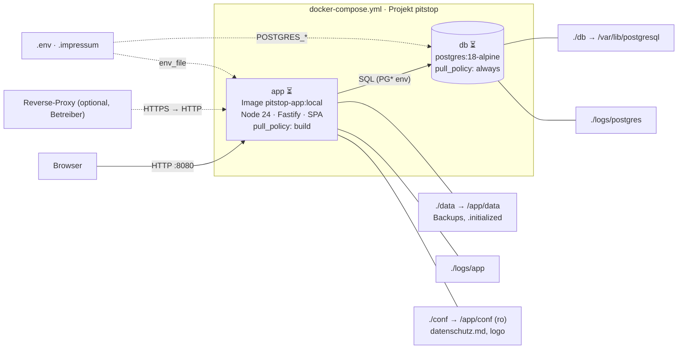
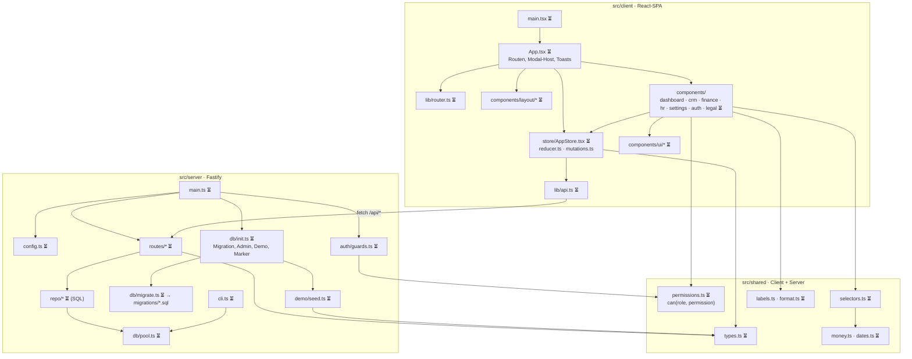
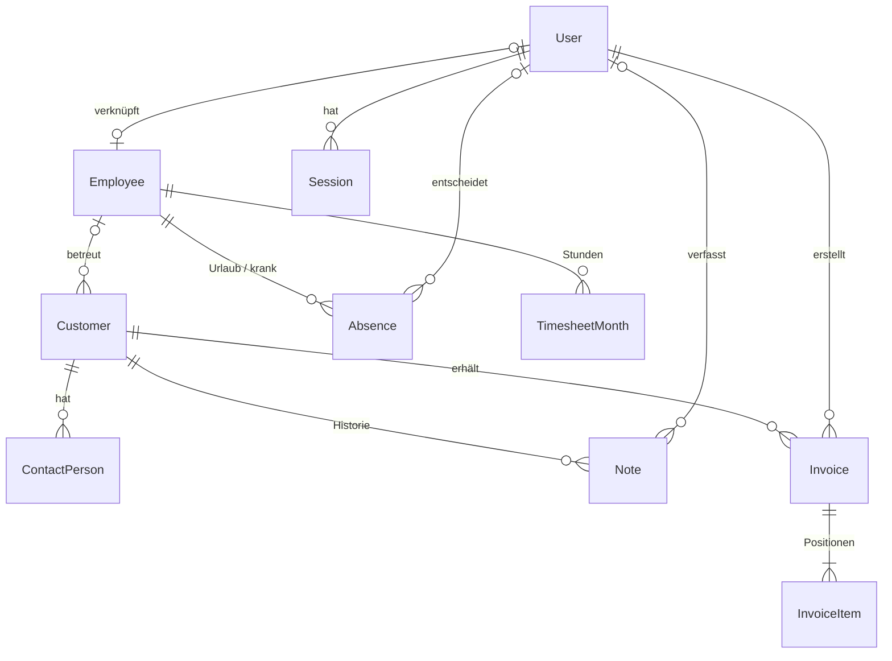

# Pitstop – Projektkarte (Graph)

@AGENTS.md

Diese Datei ist die **Landkarte** des Projekts. Mit ihr findest du nach langer Pause oder in einer neuen Sitzung die richtige Datei, ohne den ganzen Code zu lesen. Den Arbeitsstand liefert [AGENTS.md](AGENTS.md) (oben automatisch eingebunden). Das *Was* steht in [CONCEPT.md](CONCEPT.md), das *Wie* in [TECHNICAL.md](TECHNICAL.md), der Betrieb in [README.md](README.md).

**Pitstop – Business OS:** selbst gehostetes ERP/CRM für kleine Betriebe. React-SPA (Vite, TypeScript, Tailwind v4, recharts, lucide-react) und Fastify-API in **einem** Container `app`, dazu PostgreSQL 18 im Container `db`, gestartet per Docker Compose. Echte Anmeldung mit den Rollen Admin und Mitarbeiter. Module: Dashboard, Kunden (CRM), Finanzen (ERP), Personal (HR), Einstellungen. Der optionale Demo-Modus (`DEMO_MODE=true`) bringt den Demo-Betrieb Lindner Haustechnik GmbH mit.

> **Stand des Graphen:** Soll-Architektur, Code existiert noch nicht (2026-11-19). ⏳ = geplant, ✅ = umgesetzt. Beim Umsetzen Status und Pfade nachziehen (AGENTS.md Schritt 10.5).

## Lesereihenfolge

1. AGENTS.md → Wo stehen wir, was ist der nächste Schritt?
2. Diese Datei → Welche Datei ist zuständig? (Abschnitte 4 und 6)
3. Erst dann gezielt die Datei öffnen; aus CONCEPT.md und TECHNICAL.md nur den betroffenen Abschnitt lesen.

## Graphify

Graphify erzeugt aus Code und Doku einen abfragbaren Wissensgraphen. **Stand 2026-11-19 ist es auf diesem Rechner nicht installiert;** bis dahin ist diese Datei der Graph. Sobald Graphify verfügbar ist:
- Den Graphen über `pitstop/` erzeugen und seinen Bericht **vor** dem Quellcode lesen.
- Nach größeren Änderungen (neue Dateien, Routen, Komponenten, Umbenennungen) neu erzeugen.
- Ausgabeordner und Befehle hier eintragen (bisher ungeprüft) und den Ausgabeordner in `.gitignore` aufnehmen.
- Bei Widersprüchen gilt der Code, dann diese Datei. Den erzeugten Graphen nicht von Hand bearbeiten.

Damit Graphify und `grep` gute Kanten finden, folgt der Code festen Namen: Komponentendatei = Komponentenname; API-Routen `/api/<bereich>`; Server-Dateien je Bereich gleich benannt (`routes/invoices.ts` ↔ `repo/invoices.ts`); Rechte `bereich:aktion`; Selektoren mit sprechenden Funktionsnamen.

## 1. Laufzeit-Graph (Docker)

## 2. Code-Graph

Abhängigkeitsregeln: `shared/` kennt weder DOM noch Node-APIs. Client-Module importieren nur aus `ui/`, `lib/`, `store/` und `shared/`, nie quer; modulübergreifende Modals laufen über den Modal-Host in `App.tsx`. Nur `routes/*` rufen `repo/*` auf; nur `repo/*` und `db/*` schreiben SQL. Nur `shared/dates.ts → today()` liest das aktuelle Datum.

## 3. Daten-Graph

Weitere Tabellen ohne Beziehungen: `expenses`, `tasks`, `settings` (Firmendaten), `schema_migrations`. **Nie gespeichert, immer berechnet** (in `shared/selectors.ts`): Überfällig, Rechnungssummen, Mitarbeiterstatus heute, Resturlaub, Überstunden, KPIs, abgeleitete Aufgaben.

## 4. Feature-Slices

| Feature | Route (Client) | API | Einstieg Client | Weitere Komponenten | Selektoren | Rechte |
|---|---|---|---|---|---|---|
| Anmeldung | `#/login` | `auth/*` | `auth/LoginPage.tsx` ⏳ | `ChangePasswordModal`, `UserMenu` | – | – |
| Rechtsseiten | `#/impressum`, `#/datenschutz` | `public/legal`, `public/logo` | `legal/ImpressumPage.tsx` ⏳ | `DatenschutzPage` | – | öffentlich |
| Dashboard | `#/dashboard` | `bootstrap`, `tasks` | `dashboard/DashboardView.tsx` ⏳ | `KpiCard`, `RevenueExpenseChart`, `TaskList`, `AbsenceThisWeek` | `dashboardKpis`, `revenueVsExpensesLast6Months`, `derivedTasks` | `finance:view`, `task:manage` |
| Kunden | `#/kunden[/:id]` | `customers`, `customers/:id/contacts`, `customers/:id/notes` | `crm/CustomerListView.tsx` ⏳ | `CustomerDrawer`, `ContactCards`, `NoteTimeline`, `NoteComposer`, `CustomerFormModal` | `customerOpenAmount`, `lastContactDate`, `invoiceTotals` | `customer:edit`, `customer:viewInvoices` |
| Rechnungen | `#/finanzen/rechnungen[/:id]` | `invoices`, `invoices/:id/pay`, `invoices/:id/remind` | `finance/FinanceView.tsx` ⏳ | `InvoiceTable`, `InvoiceDrawer`, `InvoiceFormModal`, `LineItemsEditor` | `invoiceTotals`, `invoiceDisplayStatus`, `daysOverdue` | `finance:view` |
| Ausgaben | `#/finanzen/ausgaben` | `expenses` | `finance/FinanceView.tsx` ⏳ | `ExpenseTable`, `ExpenseFormModal`, `ExpenseCategoryBreakdown` | `expenseTotals`, `expensesByCategory` | `finance:view` |
| Personal | `#/personal[/:id]` | `employees`, `employees/:id/timesheets/:month` | `hr/HrView.tsx` ⏳ | `EmployeeDirectory`, `EmployeeCard`, `EmployeeDrawer`, `EmployeeFormModal`, `TimesheetModal`, `HoursChart`, `SickNoteModal` | `employeeStatusToday`, `vacationBalance`, `overtimeBalance` | `employee:edit`, `employee:viewRate`, `employee:viewFile:any`, `absence:reportSick` |
| Urlaub | `#/personal/urlaub` | `absences`, `absences/:id/decide` | `hr/HrView.tsx` ⏳ | `LeaveTable`, `LeaveRequestModal` | `vacationBalance`, `workdaysBetween` | `absence:decide`, `absence:createForOthers` |
| Einstellungen | `#/einstellungen/firma`, `…/benutzer` | `settings/company`, `users` | `settings/SettingsView.tsx` ⏳ | `CompanySettings`, `UserAccounts`, `UserFormModal` | – | `settings:manage`, `users:manage` |
| Global | – | `bootstrap`, `demo/*` | `layout/TopBar.tsx` ⏳ | `CommandPalette`, `QuickCreateMenu`, `UserMenu`, `Sidebar` | `searchIndex` | je Treffer |

Server-Seite je Feature: `src/server/routes/<api-bereich>.ts` ⏳ + `src/server/repo/<api-bereich>.ts` ⏳.

## 5. Ablauf-Graphen (wer löst was aus)

**Container-Start / Update**
`docker compose up -d` → `app` wird gebaut (`pull_policy: build`) → `entrypoint.sh` (chown, su-exec) → `main.ts` → `config.ts` prüft Umgebung → `db/init.ts`: auf DB warten → `migrate.ts` → keine Benutzer? (`data/.initialized` vorhanden → **Abbruch**; sonst Admin aus `.env`, ggf. `demo/seed.ts`) → Marker schreiben → Fastify lauscht auf :3000.

**Anmelden**
`LoginPage` → `POST /api/auth/login` → `auth/password.ts` (scrypt) → `auth/sessions.ts` (Token, Cookie) → Client lädt `GET /api/bootstrap` → `AppStore`. Bei `mustChangePassword` nur `ChangePasswordModal`.

**Rechnung erstellen**
`CustomerDrawer „Rechnung erstellen“` | `QuickCreateMenu` | `CommandPalette` → `useModals().open('invoice', {customerId})` → `InvoiceFormModal` (`LineItemsEditor` → `shared/money.ts`) → `mutations.createInvoice` → `POST /api/invoices` → `guards` (`finance:view`) → `repo/invoices.ts` (Sequenz für die Nummer) → Antwort → `entity/upsert` → `dashboardKpis`, `revenueVsExpensesLast6Months`, `customerOpenAmount` → Dashboard, `CustomerDrawer`, `InvoiceTable`.

**Urlaub genehmigen oder ablehnen**
`TaskList` | `LeaveTable` → (Ablehnen: `ConfirmDialog` mit Begründung) → `POST /api/absences/:id/decide` (`absence:decide`) → `upsert` → `employeeStatusToday`, `vacationBalance`, `derivedTasks` → Dashboard, Verzeichnis, Personalakte; beim Antragsteller erscheint „Dein Antrag wurde …“ (nach dem nächsten Bootstrap).

**Überfällige Rechnung mahnen**
`TaskList` | `InvoiceTable` → `POST /api/invoices/:id/remind` → in **einer** Transaktion: `dunning_level + 1`, `last_reminded_at`, System-`Note` → Antwort mit Rechnung und Notiz → `upsert` beider → `NoteTimeline`, Badge „M1“; die Aufgabe verschwindet für 14 Tage.

**Demo: Rolle wechseln / zurücksetzen**
`UserMenu` → `POST /api/demo/login {persona}` → neue Sitzung → Bootstrap → `navigate('#/dashboard')`. „Zurücksetzen“ → `POST /api/demo/reset` → `TRUNCATE` + `demo/seed.ts` → alle Clients zur Anmeldung.

## 6. Wo finde ich was?

| Ich will … | Datei |
|---|---|
| MwSt-Satz, Rundung, Euro-Eingabe | `src/shared/money.ts` |
| Ändern, was als überfällig gilt, wie KPIs oder Aufgaben entstehen | `src/shared/selectors.ts` |
| Festlegen, wer was darf | `src/shared/permissions.ts` (fachlich: CONCEPT.md Abschnitt 3); Feldfilter in `src/server/repo/*` (Serialisierer) |
| Deutsche Bezeichnungen und Badge-Farben | `src/shared/labels.ts` |
| Eine neue API-Route | `src/server/routes/<bereich>.ts` + `repo/<bereich>.ts`, registrieren in `main.ts`, Client-Aufruf in `client/store/mutations.ts` |
| Die Datenbank ändern | neue Datei `src/server/db/migrations/NNN_*.sql` (nie eine alte ändern) |
| Was beim ersten Start passiert | `src/server/db/init.ts` |
| Demo-Daten, feste Demo-Figuren, Positionsvorlagen | `src/server/demo/seed.ts`, `templates.ts` |
| Login, Sitzungsdauer, Cookie | `src/server/auth/sessions.ts` |
| Umgebungsvariablen | `src/server/config.ts` + `.env-example` + README-Tabelle |
| Impressum-Felder | `.impressum-example`, `config.ts`, `client/components/legal/ImpressumPage.tsx` |
| Eine neue Seite oder Route im Client | `src/client/lib/router.ts` + `App.tsx` + `Sidebar.tsx` |
| Ein Modal von überall öffnen | Modal-Host in `src/client/App.tsx` (`useModals`) |
| Farben und Schrift | `src/client/index.css` (`@theme`) |
| Container, Ports, Volumes, Postgres-Version | `docker-compose.yml`, `Dockerfile`, `docker/entrypoint.sh` |
| Passwort-Reset per Kommandozeile | `src/server/cli.ts`, Wrapper `docker/pitstop` |

## 7. Glossar: Oberfläche ↔ Code

| Oberfläche (deutsch) | Code |
|---|---|
| Benutzer, Zugang · Sitzung | `User` (`users`) · `Session` (`sessions`, Cookie `pitstop_session`) |
| Admin / Geschäftsführung · Mitarbeiter (Rolle) | `User.role`: `'admin'` · `'employee'` |
| Firmendaten | `settings` Schlüssel `company`, Typ `CompanySettings` |
| Demo-Modus | `DEMO_MODE`, `server/demo/*`, `AppData.demoMode` |
| Kunde · Kundennummer | `Customer` · `Customer.number` (Anzeige `KD-10001`) |
| Aktiv · Lead · Inaktiv | `CustomerStatus`: `active` · `lead` · `inactive` |
| Privat · Gewerbe · Hausverwaltung · Öffentliche Hand | `CustomerKind`: `private` · `business` · `property_mgmt` · `public` |
| Ansprechpartner (Hauptkontakt) | `ContactPerson` (`isPrimary`) |
| Historie: Notiz · Anruf · E-Mail · Termin · System | `Note.kind`: `note` · `call` · `email` · `meeting` · `system` |
| Rechnung #1042 · Position | `Invoice.number = 1042` · `InvoiceItem` |
| Offen · Bezahlt · Überfällig | `InvoiceStatus`: `open` · `paid` · *(berechnet)* `overdue` |
| Mahnstufe M1–M3 | `Invoice.dunningLevel`, `Invoice.lastRemindedAt` |
| Std. · Stk. · m · pauschal | `Unit`: `hours` · `piece` · `meter` · `flat` |
| Ausgabe · Lieferant · Kategorie | `Expense` · `supplier` · `ExpenseCategory` |
| Mitarbeiter(in) · Personalnummer | `Employee` · `personnelNumber` (`P-007`) |
| Rolle / Position im Betrieb | `Employee.jobTitle` (**nicht** `role`) |
| Abteilung | `Department`: `management` · `office` · `service` · `installation` · `planning` · `warehouse` |
| Im Dienst · Urlaub · Krank | *(berechnet)* `EmployeeStatus`: `on_duty` · `vacation` · `sick` |
| Urlaubsantrag · Krankmeldung | `Absence.kind`: `vacation` · `sick` |
| Beantragt · Genehmigt · Abgelehnt | `AbsenceStatus`: `requested` · `approved` · `rejected` |
| Resturlaub · Überstunden | *(berechnet)* `vacationBalance` · `overtimeBalance` |
| Monatsstunden (Soll/Ist) | `TimesheetMonth` (`timesheets`) |
| Stundensatz | `Employee.hourlyRateCents` |
| Personalakte | `EmployeeDrawer` |

## 8. Pflege dieser Datei

- Neue Datei, Komponente, Route, Tabelle, Selektor oder neues Recht → in den passenden Graphen bzw. in Abschnitt 4 eintragen.
- ⏳ → ✅, sobald die Datei existiert und `typecheck` grün ist.
- Umbenennungen sofort nachziehen; ein veralteter Graph ist schlimmer als keiner.
- Diese Datei bleibt eine Karte: keine Implementierungsdetails (die gehören in TECHNICAL.md), keine Protokolle (AGENTS.md).
