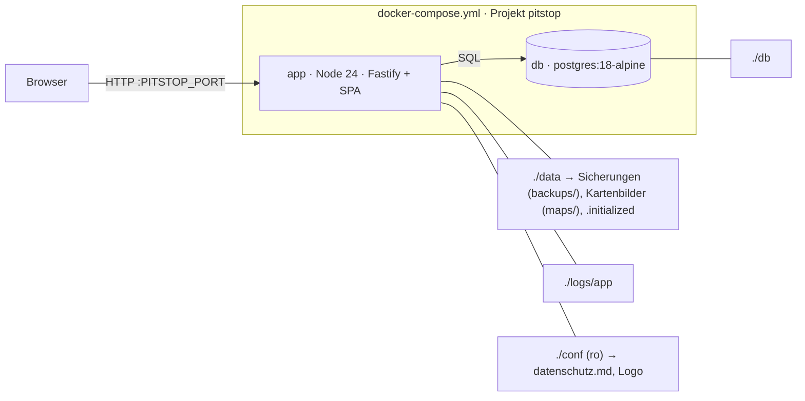
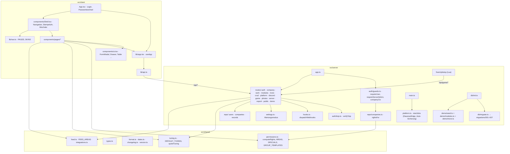

# Pitstop – Projektkarte (Graph)

@AGENTS.md

Diese Datei ist die **Landkarte** des Projekts. Mit ihr findest du die richtige Datei, ohne den ganzen Code zu lesen. Den Arbeitsstand liefert [AGENTS.md](AGENTS.md). Das *Was* steht in [CONCEPT.md](CONCEPT.md), das *Wie* in [TECHNICAL.md](TECHNICAL.md), der Betrieb in [README.md](README.md).

**Pitstop 1.0 – RP-Plattform:** Verwaltung für Werkstätten auf einem Roleplay-Server (GTA V / FiveM). Mehrere Firmen pro Server, Serververwaltung getrennt, Server-Admin als Rolle pro Konto, Gruppen & Rechte pro Firma. Module: Werkstatt (Annahme, Hallenplan, Lager, Werkzeug), Abschleppdienst (+ Fuhrpark), Tuning, Racing (+ Team, Telemetrie, Trackdays), Kunden (+ Verträge, Nachrichten), Personal (Dienstplan, Lohn, Ränge, Bewerbungen), Schulungen, Finanzen (Konten, Kasse, Auswertung); Firma mit Preisliste, Regelwerk, Pinnwand, Webhooks; Serververwaltung mit Einstellungen, Anbindungen und öffentlicher API; Zwei-Faktor, Discord-Anmeldung, Fotos zu Aufträgen, FiveM-Ressource (`fivem/pitstop`). React-SPA (Vite, TypeScript, CSS aus dem Mockup) und Fastify-API in einem Container `app`, PostgreSQL 18 im Container `db`, Docker Compose.

> **Stand des Graphen:** 2026-11-20, Version 1.0.0. Neue Dateien hier eintragen; ⏳ markiert Geplantes.

## Lesereihenfolge

1. AGENTS.md → Stand und nächster Schritt.
2. **Graphify-Bericht** `graphify-out/GRAPH_REPORT.md` (falls vorhanden) → Knoten, Gemeinschaften, Verbindungen. Abfragen mit `graphify query "…"` statt den Code zu durchsuchen.
3. Diese Datei → zuständige Datei (Abschnitte 3 und 5).
4. Erst dann gezielt die Datei öffnen.

## Graphify

- Installiert unter `/root/.local/bin/graphify`, Skill `graphify` in Claude Code (`/graphify`).
- Ausgabe in `graphify-out/` (steht in `.gitignore`, nicht von Hand bearbeiten).
- Nach größeren Änderungen (neue Dateien, Routen, Seiten, Umbenennungen) neu erzeugen. Bei Widersprüchen gilt der Code, dann diese Datei.

## 1. Laufzeit

## 2. Code

Regeln: `shared/` ohne DOM und Node. Nur `repo/*` und `db/*` schreiben SQL. Jede Firmenroute beginnt mit `companyCtx()` und prüft mit `need()`/`needSpecial()`. Fachdaten-SQL nur über `repo/records.ts` (an `company_id` gebunden).

## 3. Feature-Slices

| Feature | Client (Seite `#id`) | API | Server-Datei | Rechte (Bereich / Sonderrecht) |
|---|---|---|---|---|
| Anmeldung, Konto | `App.tsx`, `pages/Personal.tsx` (`konto`) | `auth/*`, `/me` | `routes/auth.ts` | – |
| Darstellung | `pages/Personal.tsx` (`darstellung`), `lib/app.tsx → applyPrefs` | `PATCH /me` | `routes/auth.ts` | – |
| Neuigkeiten | `pages/Personal.tsx` (`neuigkeiten`), `shared/changelog.ts` | `/announcements` | `routes/server.ts` | Server-Admin schreibt |
| Cockpit / Arbeitsfläche | `pages/Cockpit.tsx` (`WIDGETS`, `DEFAULT_WIDGETS`) | Bootstrap, `PATCH /me` (`prefs.widgets`) | `routes/company.ts`, `routes/auth.ts` | je Widget (`ok()`) |
| Kalender | `pages/Calendar.tsx` (`calendarItems`) | Bootstrap | – | was man sieht |
| Tabs, „daneben“ | `useTabs` in `Shell.tsx` | – (localStorage) | – | – |
| Lager | `pages/Lager.tsx` (`lager`) | `/c/:cid/parts[/:id/move]` | `routes/modules.ts` | `lager` (+ `buchungen`/`auszahlung` beim Buchen) |
| Tuning | `pages/Tuning.tsx` (`konfigurator`, `builds`, `pruefstand`, `pakete`), `shared/tuning.ts` | `/c/:cid/tuning[/order]`, `/dyno` | `routes/modules.ts` | `tuning` |
| Racing | `pages/Racing.tsx` (`rennkalender`, `bestenliste`) | `/c/:cid/events`, `/entries` | `routes/modules.ts` | `racing` |
| Dienstplan, Lohn | `pages/Plan.tsx` (`dienstplan`, `lohn`) | `/c/:cid/shifts`, `/wages`, `/payslips[/run|/:id/pay]` | `routes/modules.ts` | `dienstplan`, `lohn` / `lohnzahlung` |
| Schulungen | `pages/Training.tsx` (`lernen`, `kurse`, `nachweise`) | `/c/:cid/courses[/:id/lesson|test|practical]` | `routes/modules.ts` (`courseView` blendet Lösungen aus) | `schulungen` (Lernen: jedes Mitglied) |
| Fahrzeugannahme | `pages/Werkstatt.tsx → AnnahmePage, qualification` | `POST /c/:cid/intake`, `/vehicles/:id/stolen` | `routes/more.ts` | `auftraege` 2 (+ fahrzeuge/kunden/hallenplan) |
| Hallenplan, Werkzeug | `pages/Werkstatt.tsx → HallenplanPage, openBooking, WerkzeugPage` | `/c/:cid/bays`, `/bookings`, `/tools[/:id/issue|return|maintenance]` | `routes/more.ts` (+ `crud.ts`) | `hallenplan`, `werkzeug` |
| Lager-Bestellungen, Inventur | `pages/Lager.tsx` | `/c/:cid/parts/:id/orders`, `/part-orders/:id/deliver|cancel`, `/parts/:id/count` | `routes/more.ts` | `lager` |
| Einsätze, Fuhrpark | `pages/Abschlepp.tsx` | `/c/:cid/fleet[/:id/<aktion>]` | `routes/more.ts` | `leitstelle`, `fuhrpark` |
| Team, Telemetrie, Trackdays, Meisterschaft | `pages/RacingTeam.tsx`, `pages/Racing.tsx → Championship` | `/c/:cid/race-cars`, `/laps`, `/setups`, `/trackdays[/:id/bill]`, `/championship` | `routes/more.ts` | `racing` |
| Rahmenverträge, Nachrichten | `pages/Kunden.tsx` | `/c/:cid/contracts`, `/messages[/read]` | `routes/more.ts` | `vertraege`, `nachrichten` |
| Fahrzeugakte | `pages/Customers.tsx → VehicleDrawer` | Bootstrap | – | `fahrzeuge` |
| Ränge, Bewerbungen | `pages/People.tsx (Promote)` | `/c/:cid/ranks[/:id/assign]`, `/applications[/:id/hire]` | `routes/more.ts` | `raenge`, `bewerbungen` / `einladen` |
| Abwesenheit, Nachtrag | `pages/Plan.tsx → openCorrection`, `Staff.tsx` | `/c/:cid/absences`, `/corrections[/:id/decide]` | `routes/more.ts` | jede Person für sich; entscheiden `dienstplan` 3 / `dienstzeiten` 3 |
| Prüfungen, Freitext, Lizenzen | `pages/Training.tsx → PruefungenPage, Licenses` | `/c/:cid/course-sessions[/:id/join]`, `/courses/:id/review`, `/licenses` | `routes/more.ts`, `routes/modules.ts → scoreCourse` | `schulungen` |
| Finanzen, Kasse, Auswertung | `pages/Money.tsx`, `pages/Finance.tsx` (Angebote, Mahnen) | `/c/:cid/transfers`, `/closings`, `/standing[/run]`, `/tips`, `/goals`, `/bills/:id/accept|remind` | `routes/more.ts`, `routes/work.ts` | `buchungen`, `rechnungen` / `auszahlung` |
| Preisliste, Regelwerk, Pinnwand | `pages/Firma.tsx` | `/c/:cid/services`, `/rules[/:id/ack]`, `/posts[/:id/read|vote]` | `routes/more.ts` | `preisliste`, `regelwerk`, `pinnwand` |
| Live-Feed | `pages/Firma.tsx → FeedPage, useFeed`, `shared/feed.ts` | `GET /c/:cid/feed` | `routes/more.ts` | Bereiche ohne „nur eigene“ |
| Firmeneinstellungen, Webhooks | `pages/Firma.tsx → CompanyExtraCard, WebhooksCard` | `PATCH /c/:cid/extra`, `/webhooks[/:id/test]` | `routes/more.ts`, `server/hooks.ts` | `firma` 2 / 3 |
| Arbeitsflächen, Suche, Meldungen, Vorschau | `Cockpit.tsx → Workspace, addBoard, todo`; `Shell.tsx → Search, Bell, NewMenu`; `lib/app.tsx → setViewAs` | `PATCH /me` (`prefs.boards`), `GET /c/:cid/rights/:userId` | `routes/auth.ts`, `routes/more.ts` | Vorschau: `gruppen` 1 oder `zugaenge` 1 |
| Angemeldete Geräte | `pages/Personal.tsx → Devices` | `GET/DELETE /me/sessions` | `routes/auth.ts` | eigenes Konto |
| Server-Einstellungen, Anbindungen, API | `pages/Server.tsx → ServerSettingsPage, ServerIntegrations` | `/server/settings`, `/server/integrations`, `/server/api-keys`, `/v1/*` | `routes/platform.ts`, `server/settings.ts` | Server-Admin; `/v1` mit API-Schlüssel |
| Zwei-Faktor | `App.tsx → Login` (Code-Feld), `pages/Personal.tsx → TwoFactor` | `POST /auth/login` (`code`), `/me/totp/*` | `routes/auth.ts`, `auth/totp.ts` | eigenes Konto |
| Discord-Anmeldung | `App.tsx → Login`, `pages/Personal.tsx → DiscordLink` | `/auth/discord/start|callback`, `/me/discord/unlink` | `routes/discord.ts` | `.env` DISCORD_* |
| Fotos | `pages/Orders.tsx → Photos, uploadPhotos`, `pages/Werkstatt.tsx → AnnahmePage` | `PUT /c/:cid/orders/:id/photos`, `/photos/:id` | `routes/photos.ts` | `auftraege` |
| Spielserver (FiveM) | `pages/Firma.tsx → GameKeysCard`, Spiel-ID in `Company.tsx → MemberDrawer`, `fivem/pitstop/server.lua` | `/c/:cid/game-keys`, `/game/*` | `routes/game.ts` | `firma` 3; Spielserver mit Schlüssel |
| Karten-Kalibrierung | `pages/Company.tsx → calibrate, Calibration` | `PATCH /c/:cid/settings` (`mapBounds`) | `routes/company.ts` | `firma` 2 |
| Auftragstafel | `pages/Orders.tsx` (`auftraege`) | `/c/:cid/orders` | `routes/work.ts` | `auftraege` |
| Leitstelle, Karte | `pages/Leitstelle.tsx`, `pages/MapView.tsx`, `lib/mapdata.ts` | `/c/:cid/callouts`, `/c/:cid/map` | `routes/work.ts`, `routes/company.ts` | `leitstelle` / `zuteilen` |
| Kunden, Fahrzeuge | `pages/Customers.tsx` (`kunden`, `fahrzeuge`) | `/c/:cid/customers`, `/vehicles` | `routes/work.ts` | `kunden`, `fahrzeuge` / `kundensperre`, `kundenloeschen` |
| Mitarbeiter, Dienstzeiten | `pages/Staff.tsx`, Stempeluhr in `Shell.tsx` | `/c/:cid/duty/*` | `routes/work.ts` | `mitarbeiter`, `dienstzeiten` |
| Rechnungen | `pages/Finance.tsx` (`rechnungen`) | `/c/:cid/bills[/:id/pay|cancel]` | `routes/work.ts` | `rechnungen` / `storno` |
| Buchungen & Kasse | `pages/Finance.tsx` (`buchungen`) | `/c/:cid/transactions` | `routes/work.ts` | `buchungen` / `auszahlung` |
| Firmendaten, Export, Kartenbild | `pages/Company.tsx → CompanyPage` | `/c/:cid/settings`, `/map`, `/export/:set` | `routes/company.ts`, `routes/export.ts` | `firma` / `export` |
| Mitglieder & Zugänge | `pages/Company.tsx → MembersPage, MemberDrawer` | `/c/:cid/members`, `/exceptions` | `routes/company.ts` | `zugaenge`, `gruppen` / `einladen` |
| Gruppen & Rechte | `pages/Company.tsx → GroupsPage` | `/c/:cid/groups` | `routes/company.ts` | `gruppen` |
| Module, Protokoll | `pages/Company.tsx → ModulesPage, AuditPage` | `/c/:cid/modules`, `/audit` | `routes/company.ts` | `module`, `protokoll` |
| Serververwaltung | `pages/Server.tsx` (`srv*`) | `/server/*` | `routes/server.ts` | Server-Admin |
| Sicherungen | `pages/Server.tsx → ServerBackups` | `/server/backups*` | `routes/server.ts → createBackup` | Server-Admin |
| Demo | Login-Seite | `/demo/*` | `routes/demo.ts`, `demo/seed.ts` | `DEMO_MODE` |

## 4. Daten

```mermaid
erDiagram
  User ||--o{ Membership : "ist Mitglied"
  Company ||--o{ Membership : hat
  Company ||--o{ Group : hat
  Group ||--o{ GroupMember : enthält
  User ||--o{ GroupMember : ""
  Company ||--o{ PermissionException : hat
  Company ||--o{ Customer : hat
  Customer ||--o{ Vehicle : besitzt
  Company ||--o{ Order : hat
  Company ||--o{ Callout : hat
  Company ||--o{ Bill : hat
  Bill |o--o{ Transaction : "bezahlt / storniert"
  Company ||--o{ DutySession : hat
  Company ||--o{ AuditEntry : "Protokoll (NULL = Server)"
  Company ||--o{ Part : Lager
  Company ||--o{ Shift : Dienstplan
  Company ||--o{ Payslip : Lohn
  Payslip |o--o| Transaction : Auszahlung
  Company ||--o{ Course : Kurse
  Course ||--o{ CourseProgress : Nachweise
  Vehicle ||--o{ DynoRun : Prüfstand
  Company ||--o{ RaceEvent : Racing
  RaceEvent ||--o{ RaceEntry : Starter
  Company ||--o{ Bay : Hallenplan
  Bay ||--o{ BayBooking : Buchungen
  Order |o--o{ BayBooking : ""
  Company ||--o{ Tool : Werkzeug
  Company ||--o{ FleetCar : Fuhrpark
  FleetCar ||--o{ FleetLog : Fahrtenbuch
  Company ||--o{ RaceCar : Team
  RaceCar ||--o{ Setup : Setups
  RaceCar |o--o{ Lap : Runden
  RaceCar |o--o{ RaceEntry : ""
  RaceEvent |o--o{ TrackdayBooking : Trackdays
  Customer ||--o{ Contract : Verträge
  Customer ||--o{ Message : Nachrichten
  Company ||--o{ Rank : Ränge
  Company ||--o{ Application : Bewerbungen
  User ||--o{ Absence : Abwesenheit
  User ||--o{ DutyCorrection : Nachtrag
  Course ||--o{ CourseSession : Termine
  Company ||--o{ License : Lizenzen
  Company ||--o{ StandingOrder : Daueraufträge
  Company ||--o{ CashClosing : Kassenabschluss
  Company ||--o{ Goal : Ziele
  Company ||--o{ Service : Preisliste
  Service |o--o{ Order : ""
  Company ||--o{ RuleDoc : Regelwerk
  Company ||--o{ Post : Pinnwand
  Company ||--o{ Webhook : Webhooks
```

## 5. Wo finde ich was?

| Ich will … | Datei |
|---|---|
| Einen Bereich, eine Stufe oder ein Sonderrecht ergänzen | `src/shared/permissions.ts` (+ `client/lib/nav.ts` für die Seite, + Prüfung in der Route) |
| Festlegen, wie Gruppen und Ausnahmen zusammengerechnet werden | `computeRights()` in `src/shared/permissions.ts` |
| Eine neue Seite | `client/lib/nav.ts` (PAGES) + Komponente in `client/components/pages/` + Eintrag in `VIEWS` in `Shell.tsx` |
| Eine neue Firmenroute | `routes/company.ts` oder `routes/work.ts`, Tabelle in `repo/records.ts → TABLES` |
| Die Datenbank ändern | neue Datei `src/server/db/migrations/NNN_*.sql` (+ `BACKUP_TABLES`/`SEQUENCES` in `routes/server.ts`) |
| Gruppenvorlagen neuer Firmen | `GROUP_TEMPLATES` in `shared/permissions.ts` (bestehende Firmen: per Migration nachziehen, siehe 004) |
| Ein Widget für die Arbeitsfläche | `WIDGETS` in `pages/Cockpit.tsx` |
| Tuning-Preise, Klassen, Pakete (Vorgabe) | `DEFAULT_TUNING` in `shared/tuning.ts` |
| Lohnberechnung | `POST /payslips/run` in `routes/modules.ts` |
| Eine einfache neue Liste (Anlegen/Ändern/Löschen mit Recht) | `crud(app, cfg, { kind, path, area, … })` in `routes/more.ts` + Eintrag in `TABLES` (`repo/records.ts`) |
| Ein Ereignis für Live-Feed/Webhooks | `audit(…, '<Bereich>', …)`; neuen Bereich in `FEED_AREAS` (`shared/feed.ts`) eintragen |
| Meldungen / „Braucht dich“ | `todo()` in `pages/Cockpit.tsx` |
| Server-Einstellungen | `ServerSettings` in `shared/types.ts`, `server/settings.ts`, `routes/platform.ts` |
| Anbindungen-Katalog | `shared/integrations.ts` |
| Eine neue Spielserver-Funktion | `routes/game.ts` (+ Export in `fivem/pitstop/server.lua`, README dort, `tests/fivem/run.lua`) |
| Themes und Farben | `src/client/index.css`, Liste `SKINS` in `client/lib/nav.ts` |
| Karte (Umriss, Orte) | `client/lib/mapdata.ts`; Zoom/Pins in `pages/MapView.tsx` |
| Changelog-Einträge | `src/shared/changelog.ts`, Version in `shared/version.ts` und `package.json` |
| Demo-Daten | `src/server/demo/seed.ts`, Module in `demo/modules.ts`, ab 0.4 `demo/more.ts` |
| Was beim ersten Start passiert | `src/server/db/init.ts` |
| Login, Sitzungsdauer, Cookie | `src/server/auth/sessions.ts` |
| Umgebungsvariablen | `src/server/config.ts` + `.env-example` |
| Tests | `tests/api/rechte.mjs`, `tests/e2e/demo.mjs` |

## 6. Glossar: Oberfläche ↔ Code

| Oberfläche | Code |
|---|---|
| Konto · Server-Admin | `User` · `isServerAdmin` |
| Firma · Mitglied · Rang | `Company` · `Member` (`memberships`) · `rank` |
| Gruppe · Inhaber | `Group` · `isOwner` |
| Gesperrt / Sehen / Bearbeiten / Verwalten | `Level` `'x' | '1' | '2' | '3'` |
| nur eigene | `Group.own[area]`, `AreaRight.own` |
| Sonderrecht | `SpecialKey` (`zuteilen`, `kundensperre`, `kundenloeschen`, `storno`, `auszahlung`, `einladen`, `export`) |
| Ausnahme | `PermissionException` |
| Support-Zugriff | `Company.supportAccess`, `supportRights()` |
| Auftrag W-1001 | `Order` (`number`) |
| Einsatz E-201 | `Callout` |
| Rechnung R-1001 | `Bill` |
| Buchung · Kasse · Firmenkonto | `Transaction` · `account: 'kasse' | 'firma'` |
| Schicht · Stempeluhr | `DutySession` |
| Darstellung · Arbeitsfläche | `User.prefs` (`Prefs`, `widgets`) |
| Lager · Teil | `Part` (`parts`) |
| Schicht im Dienstplan | `Shift` (≠ `DutySession` = gestempelte Zeit) |
| Lohnabrechnung · Lohnlauf | `Payslip` · `POST /payslips/run` |
| Kurs · Nachweis · Praxisprüfung | `Course` · `CourseProgress` (`passedAt`, `expiresAt`) · `practicalOk` |
| Build · Prüfstand | `Order` mit `kind: 'tuning'` · `DynoRun` |
| Event · Starter | `RaceEvent` · `RaceEntry` |
| Annahme · Schadensskizze | `POST /intake` · `Order.intake` (`damage`, `checks`, `km`, `fuel`) |
| Kennzeichen-Abgleich | `Vehicle.stolen` |
| Hallenplan · Platz · Buchung | `Bay` · `BayBooking` |
| Fuhrpark · Fahrtenbuch | `FleetCar` · `FleetLog` |
| Rennwagen · Meisterschaft · Setup · Runde | `RaceCar` · `ChampRow` · `Setup` (`vals`) · `Lap` (`s1–s3`) |
| Rahmenvertrag · Nachricht | `Contract` · `Message` (`dir` in/out) |
| Rang · Befördern · Bewerbung | `Rank` · `POST /ranks/:id/assign` · `Application` |
| Abwesenheit · Nachtrag | `Absence` · `DutyCorrection` |
| Termin · Lizenz · Freitext | `CourseSession` · `License` · `Question.kind = 'text'`, `CourseProgress.answers/review` |
| Konten · Umbuchung · Kassenabschluss · Dauerauftrag · Ziel | `ACCOUNTS` · `POST /transfers` · `CashClosing` · `StandingOrder` · `Goal` |
| Angebot · Mahnung | `Bill.kind = 'angebot'` · `Bill.reminders` |
| Leistung · Nachweis-Pflicht | `Service.courseId` · `checkQualified()` |
| Regelwerk · Pinnwand · Umfrage | `RuleDoc` (`ackedBy`) · `Post` · `Poll` |
| Arbeitsfläche (weitere) | `Prefs.boards` (`Board`) |
| Vorschau als Person | `app.viewAs`, `GET /rights/:userId` |
| Wartungsmodus · API-Schlüssel | `ServerSettings.maintenance` · `ApiKey` |
| Zwei-Faktor · Discord verknüpft | `User.totpEnabled` · `User.discordLinked` (`users.discord_id`) |
| Foto · Spiel-ID · Spielserver-Schlüssel | `OrderPhoto` · `Member.gameId` · `GameKey` (`pg_…`) |
